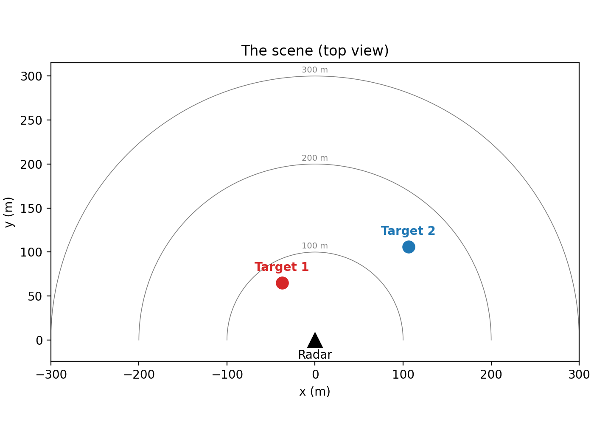
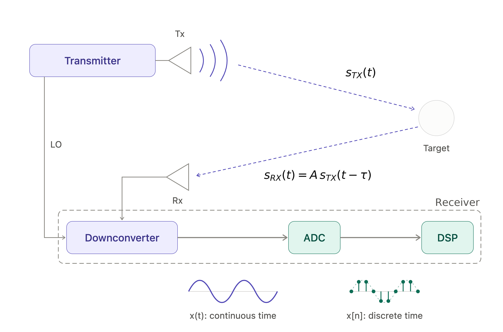
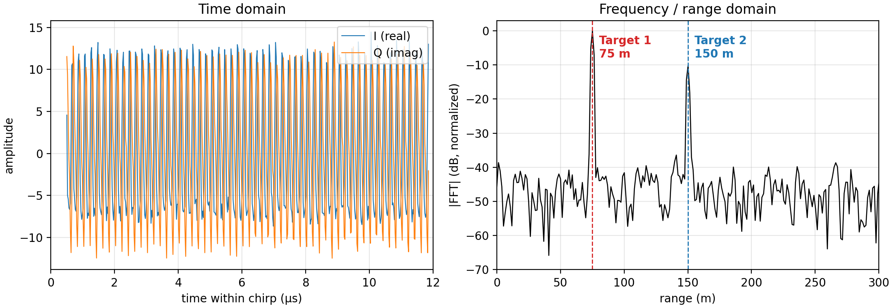
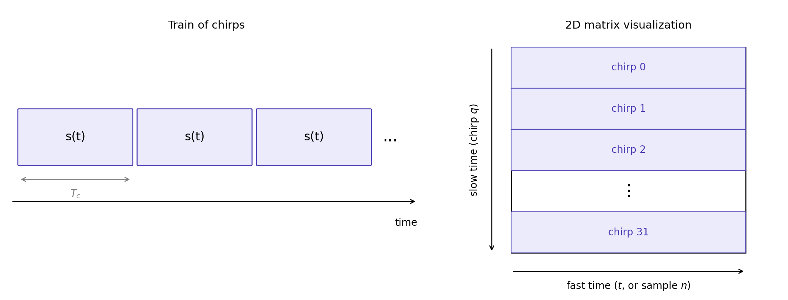
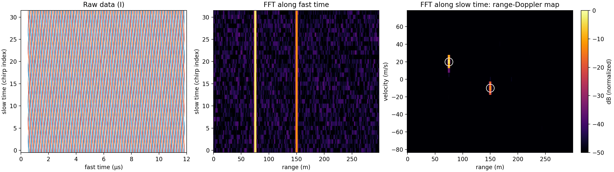
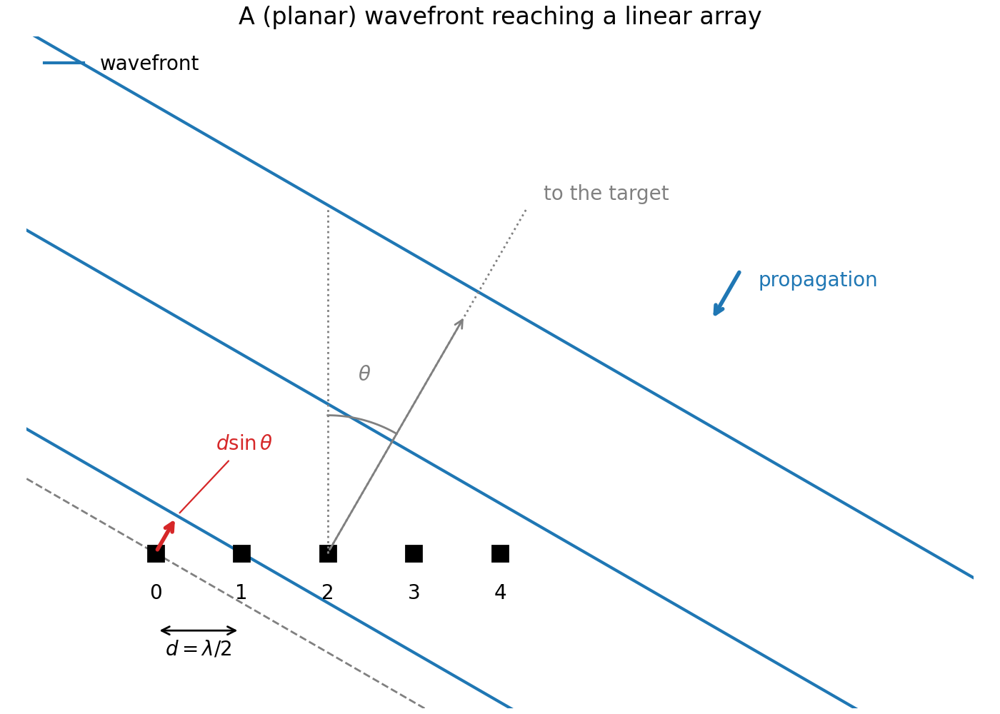
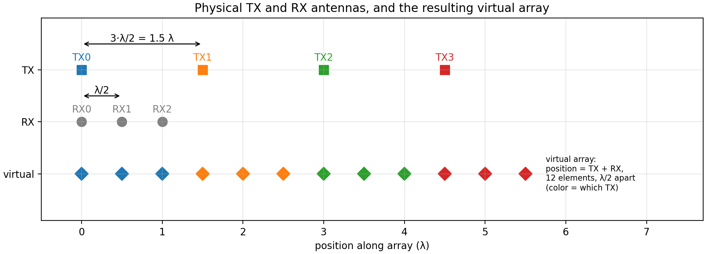
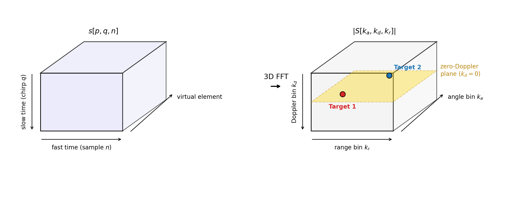
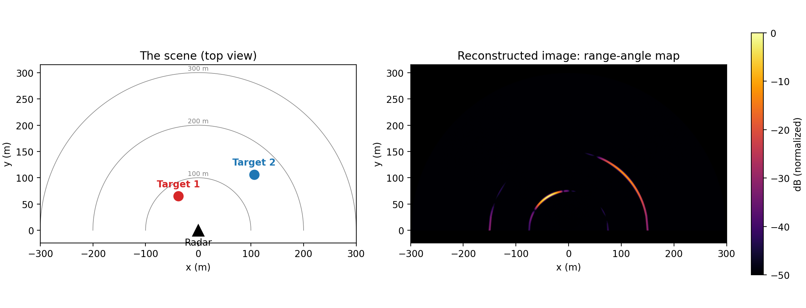

# FMCW radar basics tutorial

This repository explains how a frequency modulated continuous-wave (FMCW) radar determines range, velocity and angle of potential objects/targets in a scene. This README file that you are currently reading provides the theoretical base, which is then applied in `main.py`, the simulation.

More specifically, the simulation assumes a 77 GHz FMCW MIMO radar observing a scene with two point targets, shown below. The script `main.py` simulates the raw data sampled by the ADCs, computes the range-angle map, and generates a set of figures illustrating each stage of the processing chain.



The radar parameters are based on a commercially available chip (77 GHz, 45 MSPS ADC, 4 transmitters, 3 receivers). Feel free to clone the repo and make any adjustments you want.

For transparency, I want to make it clear that AI tools were used as coding assistants to refine the implementation of the code and improve the readability of this file.


## 1. What you will learn

- How to generate the discrete-time FMCW baseband (IF) signal model.
- How the waveform parameters (bandwidth, slope, chirp length, sampling rate) set other parameters, like the range resolution and the maximum range
- How an FMCW radar determines the range and velocity of a target
- How a MIMO architecture determines the target position in angle and why it works
- The processing chain: range FFT → averaging over chirps → angle FFT, and how to read the resulting range-angle map.

## 2. Theory and assumptions

### 2.1 The FMCW signal model

#### 2.1.1 The IF signal



In an FMCW radar, the transmit signal -call it $s_{RF}(t)$- is a linear chirp of duration $T_c$. It starts at $f_c$ and ends at $f_c + B$, where $B$ is the desired bandwidth. The bandwidth increases linearly as $f(t) = f_c + \alpha t$, where $\alpha = B / T_c$ (we will refer to $\alpha$ as the chirp slope) and $t \in \left[0, T_c \right]$. 

The transmitter emits $s_{RF}(t)$. It travels through the air and impinges on the targets present in the scene. For simplicity, assume a single target at range $R$. The receiver "sees" an echo, namely a scaled and delayed version of the transmit signal, $A s_{RF}(t-\tau)$, where $\tau = 2R/c$ ($c$ is the speed of light and the factor $2$ considers the round-trip time, ie the time it takes from the signal to travel from the radar to the target and back). The receiver mixes the echo with a copy of the transmitted chirp (this procedure is called *dechirping*). The resulting baseband (IF) signal has the following mathematical model

$$
s(t) = A \, \exp \left\lbrace j 2\pi \left( f_c \tau + \alpha \tau t - \tfrac{1}{2} \alpha \tau^2 \right) \right\rbrace, \text{ for } 0 \le t \le T_c
$$

where $A$ is the complex amplitude of the echo and the other parameters were previously defined. We will not be going into any specifics of $A$, but it is a function of the target, a few radar parameters and the radar-target distance. Also, keep in mind that $t$ is the time within the chirp (*fast time*). For simplicity, the last term in $s(t)$ is called "residual phase". For the purposes of this simulation, we will drop it.

The Fourier Transform of $s(t)$ has a closed form and it is  

$$
S(f) = \int_0^{T_c} s(t) \, e^{-j 2\pi f t} \, dt 
= A \, T_c \, e^{j 2\pi f_c \tau} \, e^{-j \pi (f - \alpha\tau) T_c} \, \text{sinc}\!\left( (f - \alpha\tau) T_c \right)
$$

Taking the magnitude, $|S(f)| = A T_c \left| \text{sinc}\!\left( (f - \alpha\tau) T_c \right) \right|$, we see that the $\text{sinc}$ peaks at $ f_\text{IF} = \alpha\tau$, where IF stands for intermediate frequency (also called beat frequency). Recall that $\tau = 2R/c$, so

$$
f_\text{IF} = \frac{2\alpha R}{c} \Longleftrightarrow R = \frac{c \, f_\text{IF}}{2\alpha}.
$$

Since frequency and range are related, the *position* of the peak also tells us the range of the target. The phase terms do not change where the peak is (NOTE: Should we discard the phase, then? No, in a lot of applications the phase is just as important as the magnitude).

What happens when several targets are present in the scene? The resulting baseband signal is the linear combination of the contribution of each target

$$
s(t) = \sum_{k=0}^{K-1} A_k \, \exp\!\left( j 2\pi \left( f_c \tau_k + \alpha \tau_k t \right) \right),
$$

where $A_k$ and $\tau_k = 2R_k/c$ are the amplitude and time delay of the $k$-th target, and $K$ is the total number of targets in the scene. In frequency domain, we would be seeing $\text{sinc}()$ centered w.r.t. $f_{\text{IF},k} = \alpha \tau_k = 2 \alpha R_k / c$, for $k=0, \dots, K-1$.

So far the signal is continuous in time. The ADC now samples it, $s[n] = s(n T_s)$ for $n = 0, \dots, N_\text{adc} - 1$, at the rate $f_s = 1/T_s$. Since the chirp lasts $T_c$, this gives up to $N_\text{adc} = \lceil T_c f_s \rceil$ samples per chirp (in practice slightly fewer, since the ADC starts after a short settling time).

Why is $f_s$ enough? Because we assume an I/Q (complex) receive chain: the in-phase and quadrature components are both sampled, so each sample is a complex number. A real signal with frequencies up to $f_\text{max}$ needs $f_s \ge 2 f_\text{max}$, but the IF frequencies are all positive (since $R > 0$), so a complex signal occupies $[0, f_\text{max}]$ and needs only $f_s \ge f_\text{max}$.

**Example.** Assume that we have a radar emitting a chirp with $f_c = 77$ GHz, $B = 120$ MHz, $T_c = 12$ µs, $f_s = 45$ MHz. The ADC acquires $N_\text{adc} = 512$ samples (11.4 µs, slightly less than $T_c$ because of the settling time) and there are two targets in the scene, one at 75 m and another one at 150 m. The slope is $\alpha = B/T_c = 10$ MHz/µs, so $f_\text{IF,max} = f_s$ would correspond to $R_{\max} = c f_s / (2\alpha) \approx 675$ m, well beyond the 300 m shown in the figures. The left figure below shows the time-domain data of a single chirp (I/Q channels), $s[n]$ for $n = 0, \dots, N_\text{adc} - 1$. The right figure shows the magnitude of its discrete frequency-domain version, $|S[k_r]|$ for $k_r = 0, \dots, N_\text{fft} - 1$ ($N_\text{fft} = 512$). In the time domain the two tones are hard to tell apart, while the FFT spectrum shows one peak per target.



#### 2.1.2 Choosing the radar parameters

We have seen above that an FMCW radar is characterized by $B$, $T_c$ and $f_s$ (whereas $A_k$ and $\tau_k$ depend on the target). The slope $\alpha = B/T_c$ and the maximum range $R_{\max}$ follow from them. Is it possible to pick _any_ value for these parameters? If the goal is purely abstract, yes. However, in practice, there will be limits and they are typically given by the specific chip being used. Typically, chip makers will provide a

1. Maximum bandwidth: $B_{\max}$;
2. Maximum sampling rate: $f_{s,\max}$;
3. Maximum slope value: $\alpha_{\max}$.

How do these parameters "shape" a radar?

- **Range resolution.** It can be shown that the range resolution, $\Delta R$, is $\Delta R = c/(2B)$. It is the smallest range separation for which two targets still show up as two distinct peaks, so it is what we use to select the bandwidth. The specific value depends on the application, so once we have $\Delta R$, it sets $B$, which in turn needs to satisfy (1)
- **Sampling rate.** The ADC samples at $f_s$, and since a higher rate lets us observe higher IF frequencies, we usually want to sample as fast as possible. In any case, we have to make sure that we pick a sampling frequency that agrees with (2)
- **Chirp length.** Having fixed $B$ and $f_s$, we are left to select the chirp length $T_c$. The slope is $\alpha = B/T_c$, so the slope limit in (3), requires $T_c \ge B/\alpha_{\max}$. Within this limit, $T_c$ is a choice appropriate that once again depends on the application. Once $T_c$ is known, we can also determine the (maximum) number of samples per chirp, $N_\text{adc} = \lceil f_s T_c \rceil$, where $\lceil \cdot \rceil$ is the ceiling (round up) operator.
- **Maximum range.** This is now a consequence of the choices above. Since $f_\text{IF} = 2\alpha R/c$, the maximum range corresponds to the maximum IF frequency. With an I/Q receiver we can set $f_\text{IF,max} = f_s$, so $R_{\max} = c f_s / (2 \alpha) = c f_s T_c / (2B)$. If this is not enough for the application, a longer chirp (a smaller slope) gives more range.

Note that the steps above are just a rough guide, not the only way to proceed.

### 2.2 Range and velocity estimation

#### 2.2.1 Fast time and slow time

So far we have considered a single chirp. Typically, a radar will send out a specific number of chirps, say $Q$, back to back (cf. the left figure below). At high-level, this is done for two reasons. First, combining the echoes of many chirps improves the signal-to-noise ratio (maybe I'll do a tutorial on this later on). Second, it allows us to measure velocity. The more chirps we send, the finer the Doppler (velocity) resolution.

For visualization purposes, simply assume that each chirp occupies a row of a matrix. Each row will have $N_{\text{adc}}$ samples (because one chirp has this amount of samples) and there will be $Q$ rows, as many as the chirps being sent out. In the right figure below, I am assuming that 32 chirps are being sent out.



Typically, we refer to the time along the rows as _fast time_, because it's the time inside a chirp. The time along the columns is called _slow time_, because it "counts" how many chirps have passed and it is slower than the time inside a chirp.

Assume a single target at range $R$, moving with velocity $v$. At each $q$-th chirp ($q = 0, \dots, Q - 1$), the target is seen at $R_q = R + v q T_c$ and the delay is $\tau_q = 2(R + v q T_c)/c$. Without going into the details, the mathematical expression of the $q$-th chirp is defined as 

$$
s[q, n] = A \, \exp\!\left( j 2\pi \left( f_c \tau + f_\text{IF} \, n T_s + f_d \, q T_c \right) \right), 
$$

where $f_\text{IF} = 2 \alpha R/c$, $f_d = 2 v /\lambda_c$ ($\lambda_c = c/f_c$) and $q = 0, \dots, Q - 1$ and $n = 0, \dots, N_\text{adc} - 1$. Note that $f_\text{IF}$ was previously defined, while $f_d$ is new. This quantity is the **Doppler frequency**, namely the rate at which the phase of the echo rotates from chirp to chirp because the target moves. It is proportional to the velocity $v$. When $v > 0$, we imply that the target is moving away from the radar (receding), and $v<0$ is approaching.

#### 2.2.2 The range-Doppler map

Why did we put the data into matrix form? It allows us to exploit fast algorithms that implement the Fourier Transform, like the FFT. An FFT along fast time (along the rows) provides us with the range information about the target. An FFT along slow time (along the columns) gives the target's velocity. Do you have to sequentially perform the FFT along the rows and then along the colums? Of course not, you can apply a 2D FFT (see below)

Consider the image below, in which we have two targets: one at 75 m, moving at +20 m/s, and another one at 150 m, moving at -10 m/s. The left-most image, shows the $\text{Re} \{ s[q,n]\}$ (the I channel of the discretized data), the center images shows the result after applying the FFT along fast time to the raw data, while the right-most image shows the result after also applying the FFT along the columns. In the center-image, we would only be able to tell that there are two targets, on at 75 and the other one at 150 m. In the right-most image, we can determine the target's range _and_ velocity. 



The right-most figure is called the "range-Doppler map" (RDM) because it's 2D (hence a map) and because it provides the range _and_ the Doppler (velocity) information. 

Assuming we have the data in matrix form as discussed above and, with a slight abuse of notation, definining it as $\mathbf{s}[q,n]$ the RDM can be computed as 

$$
\text{RDM} = |\mathbf{S}[k_d, k_r]| = |\text{FFT}_2 \{\mathbf{s}[q, n]\}|, 
$$ 

where $k_d$ is the discrete Doppler frequency and $k_r$ is the discrete intermediate frequency. Typically, the RDM is shown in log scale, so this means plotting $20\log_{10}(\text{RDM})$.

Note that the Doppler axis of the RDM is centered with respect to $v = 0$ m/s, which is done with an `fftshift` along slow time. The reason is that the FFT returns the frequencies in the order $0, 1, \dots, Q - 1$, where the second half of the bins actually are the negative frequencies (the spectrum wraps around). Since a negative Doppler frequency means a target moving towards the radar (negative velocity), `fftshift` swaps the two halves.

### 2.3 Angle estimation

#### 2.3.1 Sampling in space

In the previous sections we saw how to measure the distance of a target and its velocity relative to the radar. To determine the direction of the target, we need to sample the space dimension. How? By sampling the wavefront at several spatial positions, which requires the use of several antennas. 

Assume that we have several antennas. At a high-level, a target produces an (approximately) planar wavefront, which reaches each antenna at a slightly different time and different phase, as shown in the figure below. These phase differences between the antennas is what matters for angle estimation.



For simplicity, as shown in the figure above, we will assume that the antennas are placed on a line. This means that we can only determine the horizontal displacement (azimuth) of the target wrt to the radar. The discussion can also be extended in 2D, but we will not be doing so here. We also assume that the spacing between the antennas is $\lambda_c/2$, as explained next.

#### 2.3.2 Element spacing
Why is the $\lambda_c/2$ spacing important? Because it is the Nyquist criterion applied in space. 

Let us draw a parallel. Consider a signal $s(t)$ in the time domain that comprises frequencies up to $f_{\max}$. To avoid aliasing, we need $f_s \ge 2 f_{\max}$. Alternatively, we can say that the sampling interval must satisfy $T_s \le 1/(2 f_{\max})$. Now, let us apply the same concept in space. If we want to avoid spatial aliasing the spatial interval needs to be $d$ [m] (equivalent to $T_s$ [s] in the time domain). Therefore the spatial sampling frequency needs to be $1/d$. For a target at angle $\theta$, it can be shown that the phase seen at position $x$ along the linear array shown above is $2\pi x \sin\theta/\lambda_c$, a complex exponential in $x$ with spatial frequency $f_x = \sin\theta/\lambda_c$. For $\theta \in [-90°, 90°]$, $|\sin\theta| \le 1$, so the largest spatial frequency is $|f_x|_{\max} = 1/\lambda_c$. The (spatial) Nyquist criterion then reads

$$
\frac{1}{d} \ge \frac{2}{\lambda_c} \Longleftrightarrow d \le \frac{\lambda_c}{2}
$$

In other words, the antennas, which are our spatial samples, have to be placed at most $\lambda_c/2$ apart. With a larger spacing, we see aliasing. This concept is similar to increasing the sampling interval, $T_s$ in the time domain effectively decreasing the sampling frequency.

#### 2.3.3 Building the array with a MIMO architecture

How can we build such an array? A straightforward option is a uniform linear array of transceivers (transmitter/receivers together) spaced at $\lambda_c/2$. A multiple-input, multiple-output (MIMO) configuration is a smarter way to achieve what we want. A MIMO architecture comprises multiple independent transmitters (TX) and receivers (RX). Literally, each TX has its own power amplifier and antenna, sends a specific number of chirps, and each RX has its own receive chain.

For the purposes of this discussion, assume that a commercially available component has the following MIMO architecture
- 4 TXs spaced $3\lambda_c/2$ apart from each other (on a line), and 
- 3 RXs spaced $\lambda_c/2$ apart from each other (on a line). 

Assuming a 3D Cartesian coordinate system and defining $x_{tx,l}$ and $x_{rx,m}$ as the $x$ coordinate of the $l$-th TX and the $m$-th RX, it can be shown that for a target at an angle $\theta$ every TX/RX pair sees an extra phase that depends on the positions of where each antenna is located

$$
\Delta\varphi_{lm} = \frac{2\pi \, (x_{tx, l} + x_{rx,m}) \sin\theta}{\lambda_c},
$$

for $\forall l,m$. The realization from the equation above is that each TX/RX pair behaves like a single transceiver element at position $x_{tx,l} + x_{rx,m}$. 

The figure below shows the physical TX and RX antennas and the resulting virtual array, where the color of each element tells which TX it comes from.



What does this mean? With only 7 _physical_ antennas, we have realized a 12-element *virtual* array with $l_c/2$-spaced elements.

**Time-division multiplexing (TDM)**. For the purposes of this discussion, we will assume that TX 0 sends $Q$ chirps while all 3 receivers "listen" for the echoes, then TX 1 sends $Q$ chirps, and so on. This technique is called TDM and it is an extremely simple technique that allows the receivers to understand that a particular echo was received from a specific transmitter. This is an important aspect that is required to perform spatial processing. Other multiplexing techniques are available, but we will not talk about them here.

#### 2.3.4 From data cube to range-angle map

Each TX sends $Q$ chirps, each with $N_\text{adc}$ samples, and each TX/RX pair acts as one element of the virtual array. The data can therefore be shaped like a cube of size $N_{ve} \times Q \times N_\text{adc}$, where $N_{ve} = N_{tx} N_{rx}$.
What do we do with this cube? We perform a 3D FFT to obtain the information we want in our desired domain

$$
S[k_a, k_d, k_r] = \text{FFT}_3 \left\lbrace s[p, q, n] \right\rbrace,
$$

where $k_a$, $k_d$ and $k_r$ are the discrete angle, Doppler and range frequency bins. In the spectrum domain, ie $|S[k_a, k_d, k_r]|$, each target then shows up as a sinc-like peak in 3D, as illustrated below.



How do we get the angle information? Defining $N_\text{ang}$ the FFT size performed in angle, the target is located in $\theta = \arcsin\left( \frac{2 k_a}{N_\text{ang}} \right)$, where $k_a$ is the (spatial) bin at which the target's 3D sinc is located. As with the Doppler axis, the bins are centered around $0$ via an `fftshift`: $k_a = 0$ is the direction straight ahead ($\theta = 0^{\circ}$), negative bins are to the left and positive bins are to the right.

In this tutorial, we are considering static targets, so the cube can be collapsed into a 2D map. Because of the linearity property, this operation can be achieved in multiple ways. For example, first we obtain the averaged chirp, then we perform a 2D FFT along angle and range. Plotting the resulting magnitude, gives us a range-angle map.

The figure below shows what the code does too. The "true" scene is provided on the left. Target 1 (in red) is at $R = 75$ m, not moving, at an angle $\theta = -30°$ (to the left of the radar). Its position is $(x, y) = (75 \sin(-30°), \, 75 \cos(-30°)) \approx (-37.5, \, 65)$ m, and its SNR is 20 dB. Target 2 (in blue) is at $R = 150$ m, not moving, at an angle $\theta = +45°$ (to the right of the radar). Its position is $(x, y) = (150 \sin(45°), \, 150 \cos(45°)) \approx (106, \, 106)$ m, and its SNR is 10 dB. If you do not know what SNR means, do not worry. For the time being, simply assume is the target's amplitude. 
The figure to the right shows the reconstructed scene in the same $(x, y)$ coordinates ($x = R\sin\theta$, $y = R\cos\theta$). As can be seen, the reconstruction works as expected. We see two bright spots in the range-angle map at $R \approx 75$ m, $\theta \approx -30°$ and $R \approx 150$ m, $\theta \approx +45°$. Target 2 is dimmer than Target 1 simply because its return (amplitude) is lower than Target 1.



## 3. How to run the code

Requirements: `numpy`, `scipy` (only for the speed of light), `matplotlib`.

```
python main.py
```

At the end of `main.py`, two flags control the output:

- `SAVE` writes the figures to `docs/`.
- `SHOW` also shows the figures on screen.

Targets are a plain list of `(range m, angle deg, per-sample SNR dB)`. Add rows for more targets:

```python
targets = [
    (75.0, -30.0, 20.0),
    (150.0, 45.0, 10.0),
]
```

## 4. Code walkthrough

`main.py` is split into blocks (`# %%` cells) that follow Section 2; `plots.py` draws the figures.

**Parameters.** Carrier frequency, slope, sampling rate, chirp timing, antenna counts and positions, and the target list. Derived quantities (wavelength, bandwidth, resolutions, axes) are computed here too.

**Simulation.** For each target, the round-trip delay gives the beat phase $f_c \tau + \alpha \tau t$, which is added for every RX with its angle-dependent phase $2\pi (x_{tx} + x_{rx}) \sin\theta / \lambda$. Complex Gaussian noise is added at the end, simulating the thermal noise introduced by the receive chain (we ignore all of the other possible noise types). The result is the 3D raw cube `(element, chirp, sample)` of size $N_{ve} \times Q \times N_\text{adc}$ (12 virtual elements, one per TX/RX pair).

**Signal processing.**
1. **Range FFT** over fast time, keeping the bins that cover 0–300 m to simplify the visualization. We also multiply each chirp by a windowing function (Hann) to decrease the range sidelobes. Try to see what happens with/without it when placing to targets relatively close together in range (but not too close).
2. **Averaging over chirps.** The targets are static, so the chirps add coherently while the noise averages out.
3. **Virtual array**: the cube already has the 12 virtual elements along its first axis (`p = l·N_rx + m`), so after averaging we are left with the layout `(element, range)`.
4. **Angle FFT** across the virtual array (Hann window, zero-padded to 128 points). For $d = \lambda/2$, bin $k$ corresponds to $\sin\theta = 2k/N_\text{ang}$. The **range-angle map** is the resulting power.

**Plotting (`plots.py`).** One function per figure of Section 2. Maps are normalized and shown in dB scale.

## 5. Disclaimer

This project is for educational purposes only. It is a deliberately simplified model and has clear limitations. Results from this code should not be used for the design, validation or safety assessment of real radar systems.
